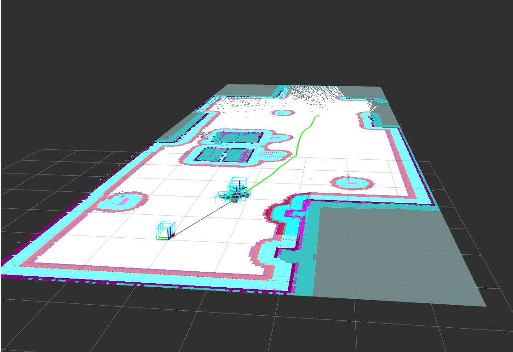

# OMNI-Nav

An omnidirectional (mecanum) robot that maps an office and navigates it autonomously with ROS 2.

<p align="center"></p>

## Status
| Part | Status |
|---|---|
| Simulation: Gazebo office world, SLAM mapping, Nav2 navigation with obstacle avoidance | ✅ Working |
| Hardware: Arduino motor and encoder firmware, Raspberry Pi ROS 2 bridge, ArUco localization | 🚧 In progress |

## Stack
ROS 2 Jazzy · Gazebo Harmonic · slam_toolbox · Nav2 (AMCL, Smac planner, MPPI controller) · Arduino Mega · Raspberry Pi · OpenCV ArUco

## Quick start (simulation)
```bash
cd ~/ros2_project/src && git clone git@github.com:Ileri005/omninav.git
cd ~/ros2_project && colcon build --packages-select omninav_sim --symlink-install && source install/setup.bash
ros2 launch omninav_sim navigation.launch.py
```
Then click **2D Goal Pose** in RViz.

## Repository
```
omninav_sim/   ROS 2 simulation package (robot model, office world, map, launch and config files)
pi/aruco/      ArUco marker generation and detection
docs/media/    images
```

*A full write-up with architecture, results and hardware details will follow when the project is complete.*
